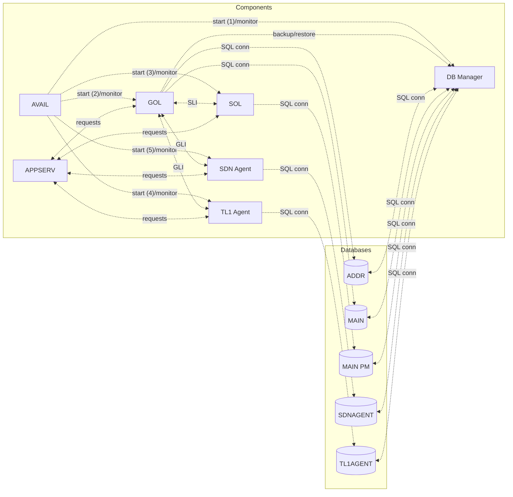

# FLC Components

The FLC architecture is composed of several **core components** that work together to provide the system's functionality. Each component has a specific role and interacts with others through well-defined interfaces.

## Core Components

### GOL (Generic Object Layer)
- **Role**: Provides object-oriented abstractions for system entities
- **Responsibilities**: Object lifecycle management, attribute storage, method dispatching
- **Interactions**: Primary interface between high-level logic and low-level resources

### SOL (Service Object Layer)
- **Role**: Manages service-level operations and business logic
- **Responsibilities**: Service orchestration, transaction management, business rule enforcement
- **Interactions**: Coordinates between GOL and external systems

### AVAIL (Availability Manager)
- **Role**: Ensures system reliability and fault tolerance
- **Responsibilities**: Health monitoring, failover coordination, redundancy management
- **Interactions**: Works with all components to maintain system stability

### APPSERV (Application Server)
- **Role**: Hosts and manages application-level services
- **Responsibilities**: Application deployment, request routing, resource allocation
- **Interactions**: Primary entry point for external requests

## Supporting Components

### TL1AGENT
- **Role**: Telecommunication Management Network (TL1) interface agent
- **Responsibilities**: TL1 protocol handling, command translation, response formatting
- **Interactions**: External network management systems

### SDNAGENT
- **Role**: Software-Defined Networking (SDN) interface agent
- **Responsibilities**: SDN controller communication, network configuration management
- **Interactions**: SDN controllers and network orchestration systems

## Component Relationships

## See Also

- [FLC Overview](/concepts/flc-overview.md) — High-level architecture
- [Platforms](/concepts/platforms.md) — Hardware platforms
- [Databases](/entities/databases.md) — Data storage
- [Acronyms](/concepts/acronyms.md) — Component acronyms and terminology

## Sources

- [FLC Components Documentation - Digest](../references/flc-components-digest.md)
- [Raw: FLC Components Documentation](../raw/2026-10-21-flc-components.md)