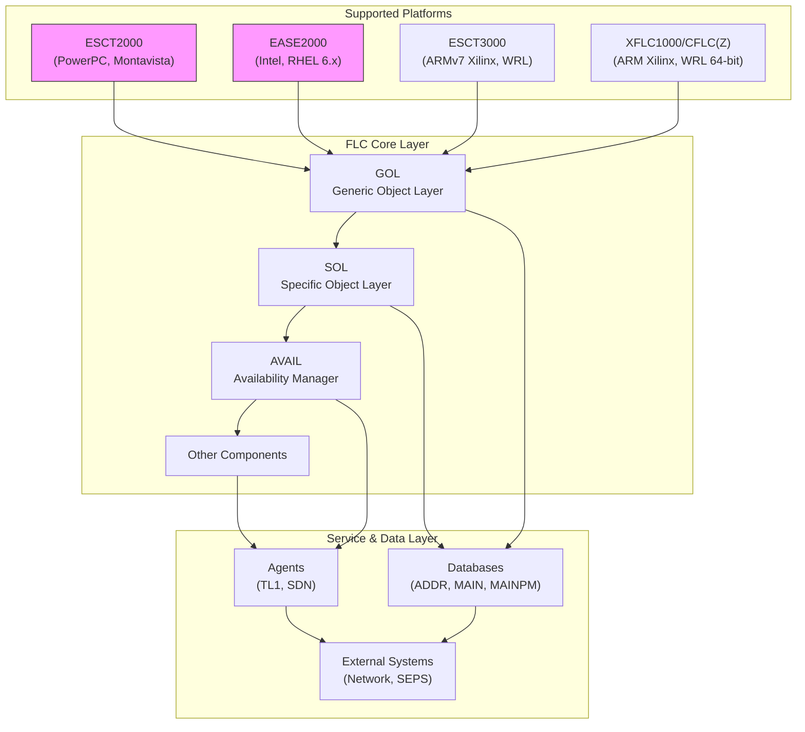

# FLC/ECMTCP Overview

The **FLC (Flexible Logical Controller)** is the core architectural framework for the **ECMTCP** system, designed to manage embedded telecommunication platforms. It provides a unified abstraction layer over heterogeneous hardware, enabling consistent service delivery across multiple product lines.

## Core Purpose

FLC serves as the **central nervous system** for ECMTCP, orchestrating:
- **Component lifecycle management** (GOL, SOL, AVAIL, etc.)
- **Platform abstraction** (ESCT2000, EASE2000, ESCT3000, XFLC1000, CFLC(Z))
- **Data flow coordination** between subsystems
- **Fault tolerance and redundancy** mechanisms

## High-Level Organization

## Key Characteristics

- **Modularity**: Components are loosely coupled and independently deployable
- **Platform Independence**: Abstracts hardware-specific details
- **Scalability**: Supports systems ranging from small embedded devices to large-scale deployments
- **Reliability**: Built-in redundancy and failover mechanisms

## See Also

- [Components](/concepts/components.md) — Individual FLC components
- [Platforms](/concepts/platforms.md) — Supported hardware platforms
- [Databases](/entities/databases.md) — Data storage entities
- [Acronyms](/concepts/acronyms.md) — ECMTCP/FLC terminology reference

## Sources

- [FLC Documentation Index - Digest](../references/flc-intro-digest.md)
- [FLC Components Documentation - Digest](../references/flc-components-digest.md)
- [Raw: FLC Documentation Index](../raw/2026-10-21-flc-intro.md)
- [Raw: FLC Components Documentation](../raw/2026-10-21-flc-components.md)