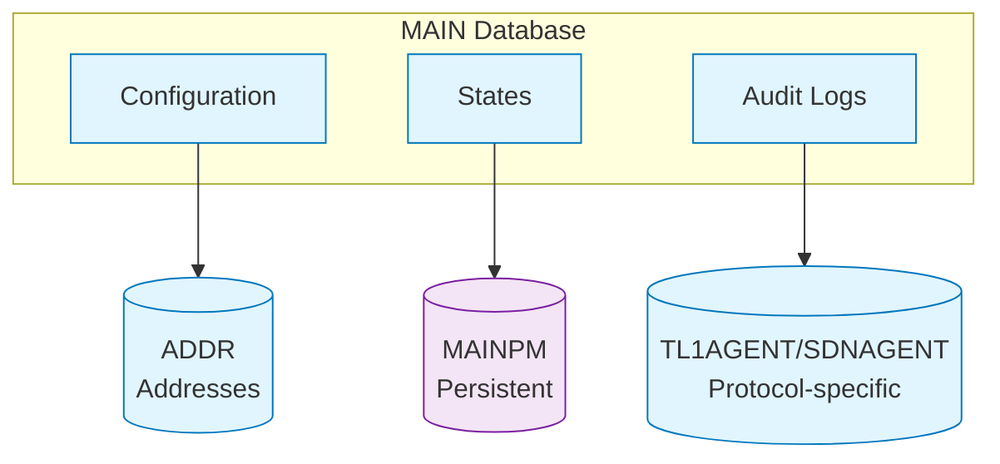

# ECMTCP Databases

The ECMTCP system utilizes several **database entities** to store and manage data across different components and functionalities. Each database serves a specific purpose and contains distinct types of information.

## Database Overview

| Database | Type | Primary Purpose | Associated Component |
|----------|------|-----------------|---------------------|
| ADDR | Relational | Network address management | TL1AGENT, SDNAGENT |
| MAIN | Relational | Core system data | All components |
| MAINPM | Key-Value | Persistent memory storage | GOL, SOL |
| SDNAGENT | Relational | SDN-specific data | SDNAGENT |
| TL1AGENT | Relational | TL1 protocol data | TL1AGENT |

## Database Details

### ADDR (Address Database)
- **Purpose**: Stores all network address information for the system
- **Data Types**:
  - IP addresses and subnets
  - MAC addresses
  - Route information
  - Network topology data
  - Address allocation records
- **Access Patterns**:
  - Frequent reads for address resolution
  - Occasional writes for configuration updates
  - Batch updates during network reconfiguration
- **Size**: Typically 10-100MB depending on network size
- **Retention**: Persistent across reboots

### MAIN (Main Database)
- **Purpose**: Central repository for all core system data
- **Data Types**:
  - System configuration
  - Component states
  - Service definitions
  - User and permission data
  - Audit logs
- **Access Patterns**:
  - High-frequency reads and writes
  - Transactional updates
  - Complex queries for reporting
- **Size**: Typically 100MB-1GB depending on deployment
- **Retention**: Persistent with full backup support

### MAINPM (Main Persistent Memory)
- **Purpose**: High-speed persistent storage for critical data
- **Data Types**:
  - Runtime state that must survive reboots
  - Critical configuration parameters
  - Session data for active connections
  - Cache data with persistence requirements
- **Access Patterns**:
  - Very high-frequency access
  - Low-latency requirements
  - Atomic update operations
- **Size**: Typically 10-50MB
- **Retention**: Persistent, battery-backed where available

### SDNAGENT (SDN Agent Database)
- **Purpose**: Stores SDN-specific configuration and state
- **Data Types**:
  - Network flow rules
  - SDN controller connections
  - Network service definitions
  - Flow statistics
- **Access Patterns**:
  - Frequent reads for flow matching
  - Periodic writes for statistics updates
  - Bulk updates during controller synchronization
- **Size**: Typically 5-50MB
- **Retention**: Persistent with controller synchronization

### TL1AGENT (TL1 Agent Database)
- **Purpose**: Manages TL1 protocol-specific data
- **Data Types**:
  - TL1 command history
  - Device inventory
  - Command templates
  - Response caches
- **Access Patterns**:
  - Command lookup and execution
  - Response formatting
  - Inventory management
- **Size**: Typically 1-10MB
- **Retention**: Persistent with command history

## Database Architecture

### Storage Backend
All databases use **embedded database engines** optimized for:
- Low memory footprint
- High reliability
- Fast recovery
- Minimal administrative overhead

### Data Organization

## Performance Considerations

### Indexing Strategy
- Primary keys on all frequently accessed fields
- Composite indexes for common query patterns
- Full-text indexes for searchable fields

### Caching
- In-memory caches for hot data
- LRU (Least Recently Used) cache eviction
- Cache consistency mechanisms

### Backup and Recovery
- Regular snapshots for all databases
- Transaction logs for point-in-time recovery
- Automated backup verification

## Constraints

See [Embedded Limits](/constraints/embedded-limits.md) for:
- Maximum database sizes per platform
- Memory usage constraints
- Storage limitations

## See Also

- [FLC Overview](/concepts/flc-overview.md) — System architecture
- [Components](/concepts/components.md) — Component details
- [Embedded Limits](/constraints/embedded-limits.md) — Platform constraints

## Sources

- [FLC Components Documentation - Digest](../references/flc-components-digest.md)
- [Raw: FLC Components Documentation](../raw/2026-10-21-flc-components.md)