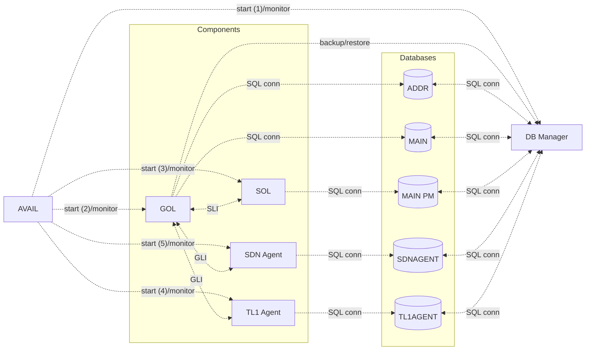

# FLC Components

## Introduction

FLC (First Level Controller) is the main controller of a network element system. It ensures:

- Configuration and persistence: equipments, cables, transmission parameters (output powers, optical spectrum, bitrates, client interfaces, etc.)
- Monitoring: report of alarms and failures, measurements and performances, protection of traffic
- AAA security, software upgrades, etc.

FLC is also known as Equipment Controller (EC). It is part of a hierarchy that includes Second Level Controller (SLC), Shelf Controller (SC), and Third Level Controller (TLC).

FLC software components (also known as ECMTCP components) are based on a robust object-oriented architecture. The main components include:

- [AVAIL](avail.md) (Availability Manager)
- [DB Manager](db_manager.md)
- [GOL](gol_and_gli.md) (Generic Object Layer)
- [SOL](sol_and_sli.md) (Specific Object Layer)
- [TL1 Agent](tl1agent.md)
- [SDN Agent](sdnagent.md)

## Architecture Diagram

## Platforms

Components are running on several platforms:

- ESCT2000 — legacy 32-bit embedded architecture based on PowerPC and Montavista Linux, deprecated
- EASE2000 (aka Booster) — 32-bit embedded architecture based on Intel and RHEL 6.x (RedHat Enterprise Linux), deprecated
- ESCT3000 — 32-bit embedded architecture based on ARMv7 Xilinx and Wind River Linux
- XFLC1000 and CFLC(Z) — 64-bit embedded architectures based on ARM Xilinx and Wind River Linux
- Host 32-bit and 64-bit — binaries for simulated environment on RHEL workstations

### Wind River Linux

Wind River provides an embedded Linux distribution based on the Yocto project. Long Term Support (LTS) versions are updated regularly with Rolling Cumulative Patch Layer (RCPL) for security purposes.

## Components Dependencies

| Component | Deliverable | Dependencies | Description |
|-----------|-------------|--------------|-------------|
| ECMTCP | N | all | Core framework |
| AVAIL | Y | APPSERV, build tools | Availability Manager |
| APPSERV | Y | build tools | Application Server |
| GOLWDM | Y | SLIWDM, PLAT-RHEL, ORBLIGHT, build tools | Generic Object Layer |
| SOLWDM | Y | SLIWDM, PLAT-RHEL, INTER, SYSTLC, build tools | Specific Object Layer |
| SDNAGENT | Y | yangASN, COMMON, AVAIL, APPSERV, GOLWDM, build tools | SDN Agent |
| TL1AGENT | Y | TL1IOM, COMMON, AVAIL, APPSERV, GOLWDM, build tools | TL1 Agent |
| DB Manager | Y | APPSERV, build tools | Database Manager |
| COMMON | Y | APPSERV, SLIWDM, build tools | Common utilities |
| SLIWDM | Y | build tools | Service Layer Interface |
| ORBLIGHT | N | build tools | Optical layer |
| GLIAGT | N | GOLWDM, ORBLIGHT, build tools | Generic Layer Interface |
| INTER | N (deprecated) | build tools | Interface component |
| PLAT-RHEL | Y | IRM, COMMON, AVAIL, APPSERV, build tools | RHEL platform |
| TL1IOM | N (part of TL1AGENT) | none | TL1 I/O |
| SYSTLC | N (part of SOLWDM) | none | System layer |
| yangASN | N (part of SDNAGENT) | none | YANG models |
| Albie | N | none | Build tool |

**Note:** Platform components depend on binaries provided by other platform packages.

## Versioning

Software components have a dedicated, incremental, and unique numbering system to identify versions and deliveries. The numbering takes into account the release number, the component version, and the build number.

### ClearCase to Git Migration

Historically, components were versioned with ClearCase. The numbering followed patterns like:
- `FLC-SOLWDM-V02.08.25-01-arm.rpm` — component SOLWDM, version 25 of branch V02.08, build 1
- `FLC-TL1AGENT-V02.09.29-02-aarch64.rpm` — component TL1AGENT, version 29 of branch V02.09, build 2

After migrating to Git, the numbering was **simplified and unified** with a clear indication of release:

- Format: `a.b.c.d.e` where:
  - `a.b.c` are the release numbers (e.g., 8.2.0); `c` is zero unless for maintenance release
  - `d.e` are the major and minor numbers of component version
  - Minor number is incremented only if the component must be rebuilt due to dependencies
- Each component has a unique script `version.sh` to get and set (or increment) version

## Software Tools

### Build System

The build system uses a combination of custom scripts and standard tools:

- **Albie**: Build automation tool
- **wpack**: Delivery packaging tool (Python3 script)
- **version.sh**: Version management script per component
- **mtcp_magic_delivery.sh**: Shell script for building patches

### Delivery Process

Software deliveries follow a structured process:

1. Components are built with the build tools
2. Deliveries are packaged with wpack
3. Delivery notes are generated automatically
4. Deliveries are tracked in a centralized system

Each delivery includes:
- Binary packages for each platform
- Documentation
- Delivery notes with release features and changes
