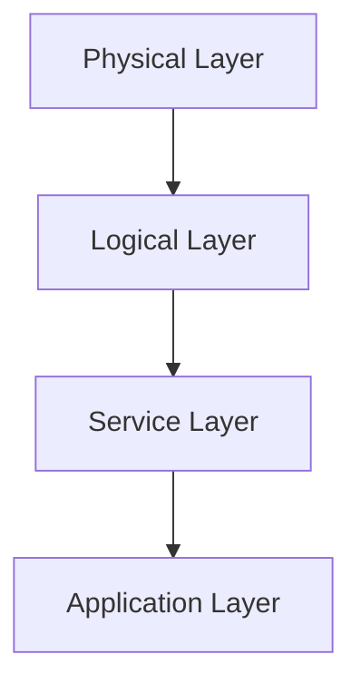
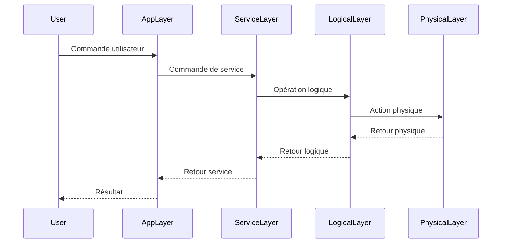

# Object Layers - Couches d'objets ECMTCP

Le système ECMTCP organise les objets réseau selon une architecture en **couches** (layers). Cette organisation hiérarchique permet une gestion modulaire et scalable des ressources réseau.

## Principe

Les objets sont organisés en couches logiques, chaque couche ayant des responsabilités spécifiques :

## Couches principales

### 1. Physical Layer (Couche physique)

**Responsabilité** : Représentation des équipements physiques et de leurs interfaces.

**Objets typiques** :
- Équipements réseau (routeurs, commutateurs, etc.)
- Cartes et modules matériels
- Ports physiques
- Connexions physiques

**Composant principal** : GOL (Gestion des Objets Logiques) avec les modules de bas niveau.

### 2. Logical Layer (Couche logique)

**Responsabilité** : Abstraction des ressources physiques en objets logiques manipulables.

**Objets typiques** :
- Objets réseau logiques
- Circuits et connexions logiques
- Groupes de ressources
- Topologies logiques

**Composant principal** : GOL (Gestion des Objets Logiques).

### 3. Service Layer (Couche service)

**Responsabilité** : Gestion des services et commandes de haut niveau.

**Objets typiques** :
- Commandes de service
- Workflows d'exploitation
- Politiques de service
- Contrats de niveau de service (SLA)

**Composant principal** : SOL (Service Order Logic).

### 4. Application Layer (Couche application)

**Responsabilité** : Interfaces utilisateur et applications métiers.

**Objets typiques** :
- Interfaces utilisateur (CLI, GUI, API)
- Applications de gestion
- Rapports et tableaux de bord

**Composant principal** : APPSERV (Application Server).

## Interactions entre couches

## Avantages de l'architecture en couches

1. **Modularité** : Chaque couche peut être modifiée indépendamment
2. **Abstraction** : Les couches supérieures sont isolées des détails d'implémentation des couches inférieures
3. **Maintenabilité** : Simplification de la maintenance et des évolutions
4. **Réutilisabilité** : Les objets d'une couche peuvent être réutilisés par plusieurs couches supérieures
5. **Testabilité** : Chaque couche peut être testée de manière isolée

## Correspondance avec les composants ECMTCP

| Couche | Composant principal | Autres composants |
|--------|---------------------|-------------------|
| Physical | GOL | AVAIL |
| Logical | GOL | COMMON |
| Service | SOL | TL1AGENT, SDNAGENT |
| Application | APPSERV | GLIAGT |

## See Also

- [GOL Component](../entities/gol.md)
- [SOL Component](../entities/sol.md)
- [APPSERV Component](../entities/appserv.md)
- [AVAIL Component](../entities/avail.md)
- [COMMON Component](../entities/common.md)
- [TL1AGENT Component](../entities/tl1agent.md)
- [SDNAGENT Component](../entities/sdnagent.md)
- [IRM-16WX Component](../entities/irm-16wx.md)
- [GLIAGT Component](../entities/gliagt.md)
- [SLI Component](../entities/sli.md)
- [ADDR Database](../entities/addr-db.md)
- [MAIN Database](../entities/main-db.md)
- [MAIN_PM Database](../entities/mainpm-db.md)
