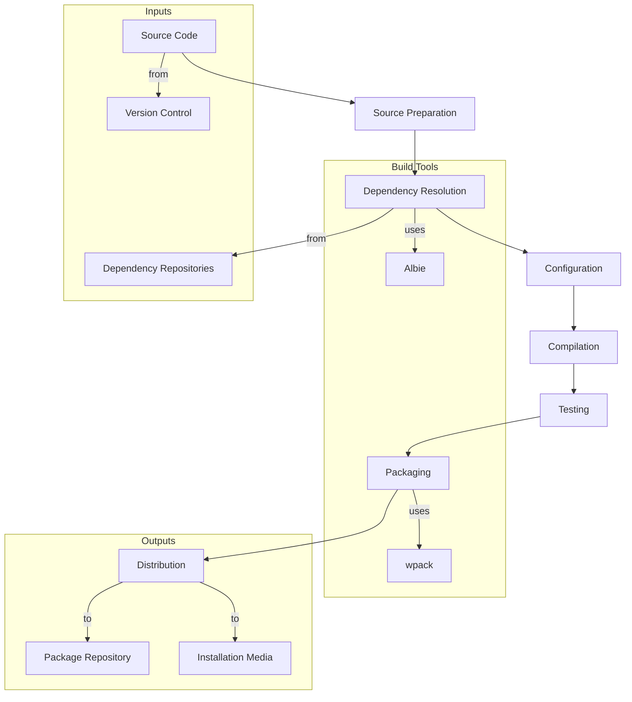

The ECMTCP build process is a multi-stage workflow that transforms source code into distributable packages, utilizing [Albie](../entities/albie.md) for compilation and [wpack](../entities/wpack.md) for packaging.

## Overview

The build process follows a standardized pipeline that ensures consistency across all ECMTCP components and platforms. It includes source preparation, dependency resolution, compilation, testing, and packaging stages. The process relies on [dependency management](dependency-management.md) for handling required libraries and tools, and [build scripts](../entities/build-scripts.md) for custom automation.

## Build Pipeline Stages

### 1. Source Preparation
- Checkout source code from version control
- Apply patches and customizations
- Generate build configuration files
- Validate source integrity

### 2. Dependency Resolution
- Identify required dependencies
- Check for available versions
- Download and verify dependencies
- Cache dependencies for reuse

### 3. Configuration
- Parse build configuration
- Set platform-specific parameters
- Configure compiler flags and options
- Prepare build environment

### 4. Compilation
- Compile source files
- Link object files
- Generate libraries and executables
- Perform optimization passes

### 5. Testing
- Run unit tests
- Execute integration tests
- Validate build artifacts
- Generate test reports

### 6. Packaging
- Collect build artifacts
- Generate package metadata
- Create platform-specific packages
- Sign and verify packages

## Build Pipeline Diagram

## Build Environment Requirements

### Required Tools
- Albie (build automation)
- wpack (packaging)
- C++ Compiler (g++, clang, or MSVC)
- CMake or Make
- Version control (git)
- Package managers (yum, apt, etc.)

### Environment Variables
- `FLC_ROOT`: Root directory of ECMTCP source tree
- `BUILD_DIR`: Build output directory
- `INSTALL_DIR`: Installation directory
- `PACKAGE_DIR`: Package output directory

## Build Configuration

Builds are configured through a combination of global settings and component-specific configurations.

### Configuration Hierarchy
1. **Global Configuration**: System-wide build settings
2. **Component Configuration**: Component-specific build parameters
3. **Platform Configuration**: Platform-specific overrides
4. **Environment Configuration**: Environment-specific settings

### Example Configuration Files
- `build-config.yaml`: Global build configuration
- `component-build.yaml`: Component-specific configuration
- `platform-linux.yaml`: Linux-specific settings
- `platform-windows.yaml`: Windows-specific settings

## Build Modes

### Development Build
- Debug symbols enabled
- Optimization disabled
- Assertions enabled
- Verbose output

### Release Build
- Debug symbols stripped
- Optimization enabled
- Assertions disabled
- Minimal output

### Test Build
- Coverage instrumentation
- Test hooks enabled
- Extended logging
- Debug information

## Build Optimization

### Parallel Builds
- Utilize multiple CPU cores
- Parallelize independent components
- Optimize I/O operations

### Incremental Builds
- Track file dependencies
- Rebuild only changed components
- Cache intermediate results

### Dependency Caching
- Cache downloaded dependencies
- Cache compiled libraries
- Cache generated files

## Build Validation

### Pre-build Checks
- Source code validation
- Dependency availability
- Configuration syntax
- Environment requirements

### Post-build Checks
- Artifact verification
- Package integrity
- Dependency completeness
- Platform compatibility

## Open Questions

- How are build configurations versioned and managed across releases?
- What are the specific optimization strategies for large components?
- How is build reproducibility ensured across different environments?
- What are the fallback mechanisms for failed builds?
