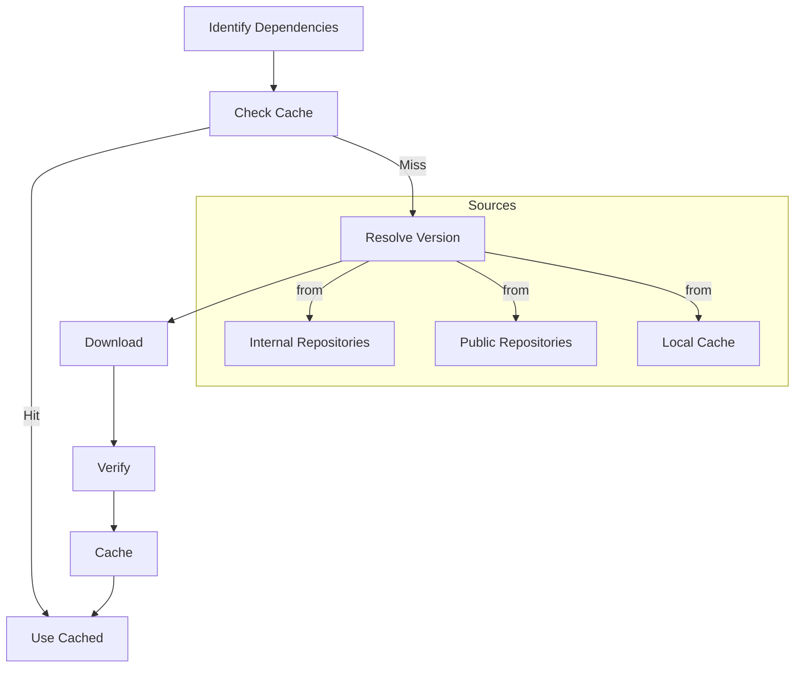
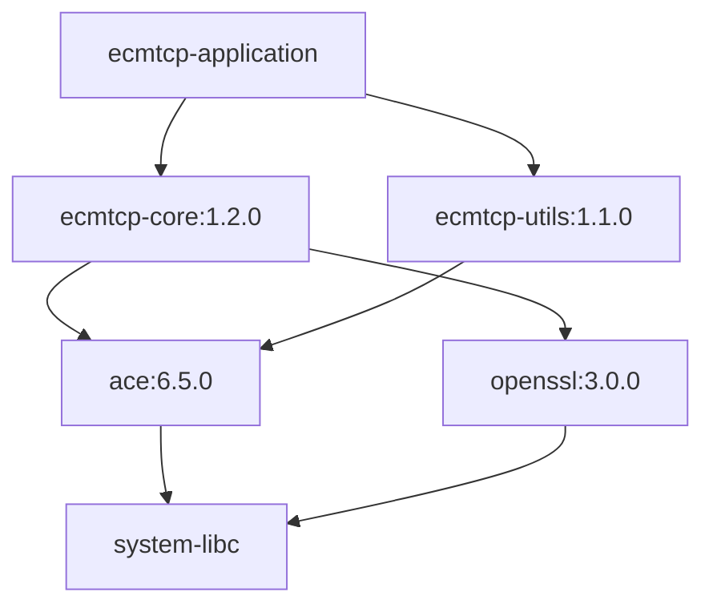

Dependency management in ECMTCP ensures that all required libraries, frameworks, and tools are available, compatible, and properly integrated into the [build process](build-process.md).

## Overview

ECMTCP components rely on a mix of internal libraries (developed within the project) and external dependencies (third-party libraries and tools). The dependency management system handles identification, resolution, downloading, and integration of these dependencies. It is a critical component of the overall [build process](build-process.md) managed by [Albie](../entities/albie.md).

## Dependency Types

### Internal Dependencies
- Libraries developed within ECMTCP
- Shared components between subsystems
- Internal tools and utilities

### External Dependencies
- Third-party open source libraries
- Commercial libraries
- System libraries and tools

### Development Dependencies
- Build tools (Albie, wpack)
- Compilers and linkers
- Testing frameworks
- Code analysis tools

## Dependency Resolution Process



## Dependency Specification

Dependencies are specified in configuration files using a standardized format.

### Dependency Manifest Example
```yaml
dependencies:
  - name: ace
    type: external
    version: 6.5.0
    source:
      type: git
      url: https://github.com/DOCGroup/ACE_TAO.git
      tag: ACE-6.5.0
    license: DOC Group License
    platforms:
      - linux
      - windows
      - macos
    
  - name: openssl
    type: external
    version: 3.0.0
    source:
      type: tarball
      url: https://www.openssl.org/source/openssl-3.0.0.tar.gz
      sha256: 1234567890abcdef...
    license: Apache-2.0
    platforms:
      - linux
      - windows
      - macos
    
  - name: ecmtcp-core
    type: internal
    version: 1.2.0
    source:
      type: git
      url: internal://ecmtcp-core
      branch: release/1.2
    platforms:
      - linux
      - windows
```

## Version Management

### Version Pinning
- Exact versions for production builds
- Version ranges for development builds
- Floating versions for latest features (with caution)

### Version Compatibility
- Semantic versioning (SemVer) compliance
- Backward compatibility guarantees
- Deprecation policies
- Migration paths

### Version Conflicts Resolution
- Dependency tree analysis
- Version constraint solving
- Conflict detection and resolution
- Alternative selection

## Dependency Caching

### Cache Structure
- Source cache: Downloaded dependency archives
- Build cache: Compiled dependency libraries
- Install cache: Installed dependency packages

### Cache Locations
- Local cache: Per-developer machine
- Shared cache: Team/shared build servers
- CI cache: Continuous integration servers

### Cache Management
- Cache validation and cleanup
- Cache size limits
- Cache expiration policies
- Cache sharing mechanisms

## Dependency Verification

### Integrity Verification
- Checksum verification (SHA-256, MD5)
- Signature verification (GPG, digital signatures)
- Source verification (trusted repositories)

### Compatibility Verification
- Platform compatibility checks
- Compiler compatibility checks
- Architecture compatibility checks

### Security Verification
- Vulnerability scanning
- License compliance checking
- Security policy enforcement

## Dependency Graph



## Dependency Lifecycle

### Addition
- Identify need for dependency
- Evaluate alternatives
- Select and approve dependency
- Add to dependency manifest

### Update
- Monitor for new versions
- Evaluate compatibility
- Test updates
- Roll out updates

### Removal
- Identify unused dependencies
- Verify no dependencies
- Update dependency manifest
- Clean up cached files

## Dependency Tools Integration

### Albie Integration
Albie handles dependency resolution as part of the build process:
- Automatically resolves dependencies
- Downloads and caches dependencies
- Verifies dependency integrity
- Integrates dependencies into build

### wpack Integration
wpack includes dependencies in packages:
- Bundles required dependencies
- Generates dependency metadata
- Handles dependency installation
- Manages dependency conflicts

## Open Questions

- How are dependency conflicts between different components resolved?
- What is the process for approving new external dependencies?
- How are security vulnerabilities in dependencies handled?
- What are the caching strategies for large dependencies?
- How is dependency licensing compliance managed?
