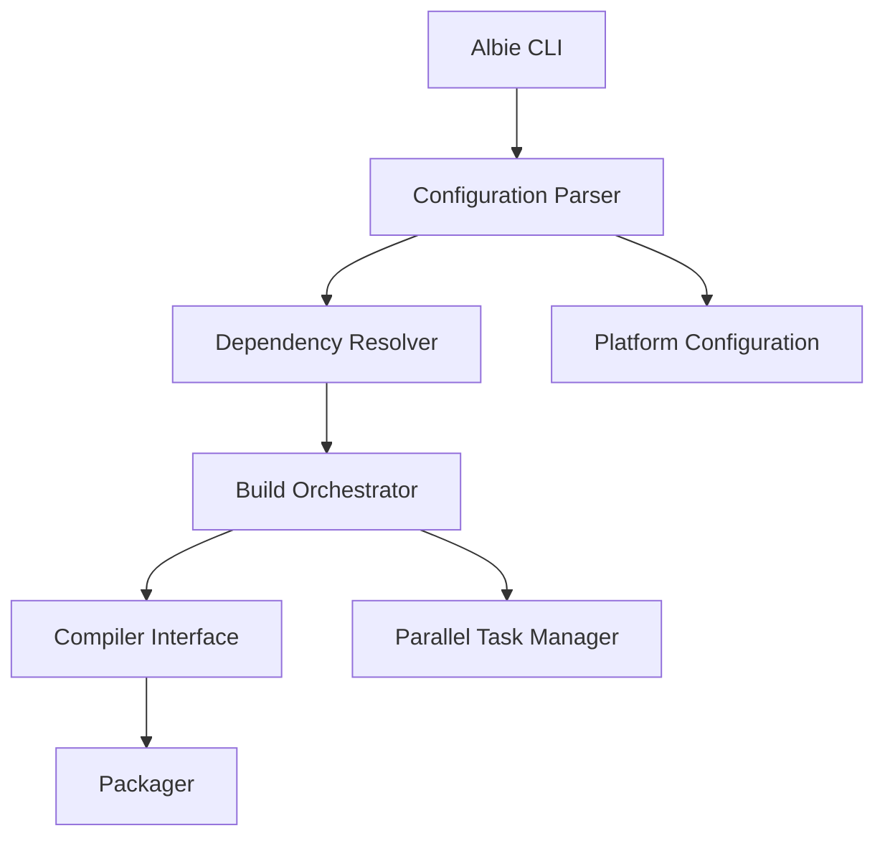

Albie is the primary build automation tool used within the ECMTCP project for managing compilation, packaging, and deployment workflows.

## Overview

Albie provides a standardized interface for building ECMTCP components, handling dependencies, and generating deliverables. It is designed to work across multiple platforms and environments. Albie works in conjunction with [wpack](wpack.md) for packaging and [build scripts](build-scripts.md) for custom automation, as part of the overall [build process](../concepts/build-process.md).

## Key Features

- **Cross-platform compilation**: Supports building on various operating systems and architectures
- **Dependency management**: Automatically resolves and includes required dependencies
- **Parallel builds**: Optimizes build times through parallel processing
- **Configuration management**: Centralized build configuration
- **Packaging**: Generates installable packages and distributions

## Architecture



## Usage Patterns

### Basic Build Command
```bash
albie build [target] [options]
```

### Common Options
- `--config`: Specify build configuration file
- `--target`: Specify build target
- `--clean`: Clean build artifacts before building
- `--verbose`: Enable verbose output

## Configuration

Albie uses YAML-based configuration files to define build parameters, dependencies, and platform-specific settings.

### Example Configuration Structure
```yaml
project:
  name: ecmtcp-component
  version: 1.0.0
  
dependencies:
    - library: ace
      version: 6.5.0
    - library: openssl
      version: 3.0.0
      
build:
  targets:
    - name: linux-x86_64
      compiler: g++
      flags: -std=c++17 -O2
    - name: windows-x64
      compiler: cl
      flags: /O2 /std:c++17
```

## Integration with ECMTCP

Albie is integrated into the ECMTCP build pipeline and works in conjunction with other tools like wpack for complete build and packaging workflows.

## Platform Support

- Linux (x86_64, ARM64)
- Windows (x64, ARM64)
- macOS (Intel, Apple Silicon)

## Open Questions

- How does Albie handle version conflicts in dependencies?
- What are the specific optimization techniques used for parallel builds?
- How is Albie integrated with continuous integration systems?
