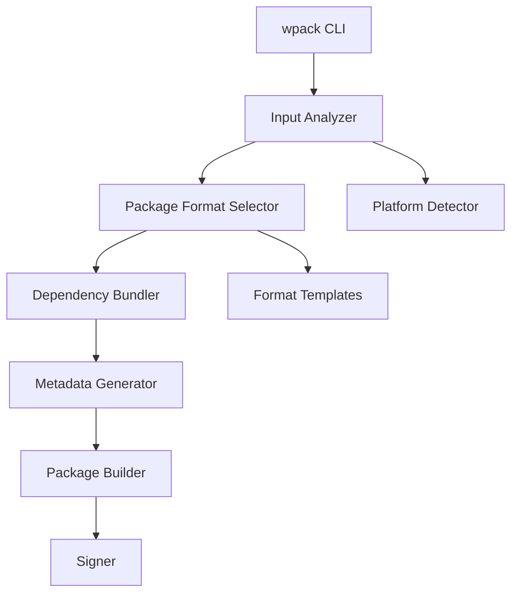
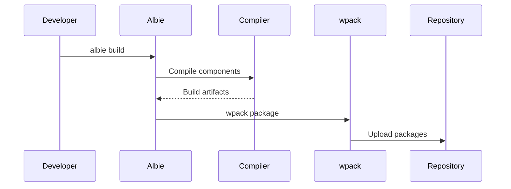

wpack is the packaging tool used within the ECMTCP project for creating distributable packages, installers, and deployment artifacts.

## Overview

wpack takes compiled binaries and resources, and packages them into various formats suitable for distribution and deployment. It works in conjunction with [Albie](albie.md) to provide a complete build-to-package pipeline, as described in the [build process](../concepts/build-process.md).

## Key Features

- **Multi-format packaging**: Supports various package formats (RPM, DEB, MSI, tar.gz, etc.)
- **Dependency bundling**: Includes all required dependencies in the package
- **Platform-specific packaging**: Generates packages appropriate for target platforms
- **Metadata generation**: Creates package metadata and manifests
- **Signature and verification**: Supports package signing and integrity verification

## Supported Package Formats

| Format | Platform | Description |
|--------|----------|-------------|
| RPM | Linux (Red Hat, CentOS, Fedora) | Red Hat Package Manager format |
| DEB | Linux (Debian, Ubuntu) | Debian package format |
| MSI | Windows | Windows Installer format |
| PKG | macOS | macOS package format |
| tar.gz | Cross-platform | Compressed tarball |
| zip | Cross-platform | ZIP archive |

## Architecture



## Usage Patterns

### Basic Packaging Command
```bash
wpack package [input] [options]
```

### Common Options
- `--format`: Specify package format (rpm, deb, msi, etc.)
- `--output`: Specify output directory
- `--name`: Override package name
- `--version`: Override package version
- `--arch`: Specify target architecture
- `--sign`: Enable package signing

## Configuration

wpack uses configuration files to define packaging parameters, file lists, and platform-specific settings.

### Example Configuration Structure
```yaml
package:
  name: ecmtcp-application
  version: 2.0.0
  description: ECMTCP Application Package
  vendor: ECMTCP
  
files:
  include:
    - bin/*
    - lib/*
    - config/*
    - share/*
  exclude:
    - "*.debug"
    - "*.pdb"
    
dependencies:
  runtime:
    - libace.so.6.5.0
    - libssl.so.3
  
platforms:
  - linux-x86_64
  - windows-x64
```

## Integration with Albie

wpack is typically invoked as part of the Albie build pipeline. After Albie compiles the components, wpack takes the build artifacts and creates distributable packages.

## Build Pipeline Integration



## Open Questions

- How does wpack handle platform-specific dependency resolution?
- What are the signing mechanisms and key management approaches?
- How are package repositories managed and versioned?
