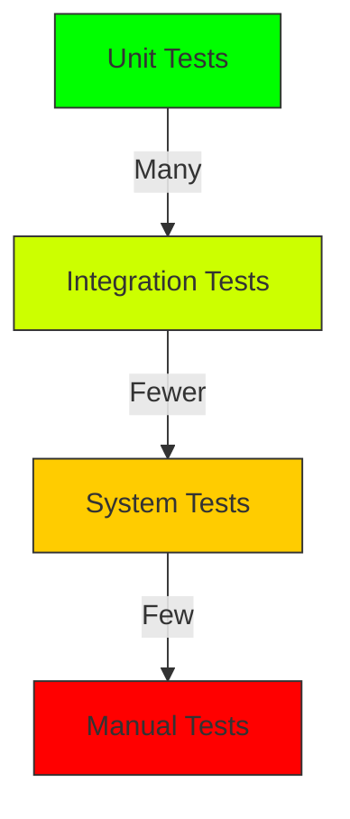

---
type: Concept
title: Test Best Practices
description: Established best practices and guidelines for writing effective tests in ECMTCP.
tags: [testing, ecmtcp, best-practices, guidelines, quality]
status: draft
stale_after: 2027-11-04
generated: { by: opencode/mistral-medium, at: 2026-11-04T00:00:00Z }
sources:
  - id: observation
    resource: "observation:2026-11"
    title: Direct observation of ECMTCP testing conventions
--- 

# Test Best Practices

**Test best practices** are the established guidelines and conventions that ensure ECMTCP tests are effective, maintainable, and reliable.

**Related concepts**:
- [Test Strategies](./test-strategies.md) — Overall testing approaches
- [Test Frameworks](./test-frameworks.md) — Tools for implementing best practices
- [Test Levels](./test-levels.md) — Granularity considerations for best practices
- [Test Tools](../entities/test-tools.md) — Utilities supporting best practices

## General Principles

### The F.I.R.S.T. Principles
- **Fast**: Tests should execute quickly to enable frequent running
- **Isolated/Repeatable**: Tests should not depend on external factors or each other
- **Self-validating**: Tests should have clear pass/fail criteria
- **Timely**: Tests should be written at the same time as the code they verify

### Test Pyramid


## Test Writing Guidelines

### Naming Conventions
- Test file names: `<module>_test.cpp` or `test_<module>.cpp`
- Test case names: `Test<ClassName>` or `<ClassName>Test`
- Test names: Descriptive of behavior being tested, using `Should_` or `When_` prefixes

### Structure
- **Arrange-Act-Assert** pattern for each test
- Single responsibility per test
- Clear separation between setup, execution, and verification

### Assertions
- Use specific assertions over generic ones
- Include descriptive messages in assertions
- Test one thing per assertion

## Test Organization

### Directory Structure
```
tests/
├── unit/
│   ├── <module>/
│   │   ├── <component>_test.cpp
│   │   └── test_<component>.cpp
├── integration/
│   ├── <subsystem>/
│   │   └── <scenario>_test.cpp
└── system/
    └── <end-to-end>_test.cpp
```

### Test Suites
- Group related tests into logical suites
- Use test fixtures for common setup/teardown
- Separate fast and slow tests

## Code Quality in Tests

### Maintainability
- Tests are code and should follow the same quality standards
- Refactor tests along with production code
- Keep tests simple and focused

### Documentation
- Include comments explaining non-obvious test logic
- Document test assumptions and preconditions
- Maintain a README for complex test suites

## Open Questions

- What are the specific coding standards for test files?
- How are test reviews conducted in the development process?
- Are there automated quality checks for test code?
