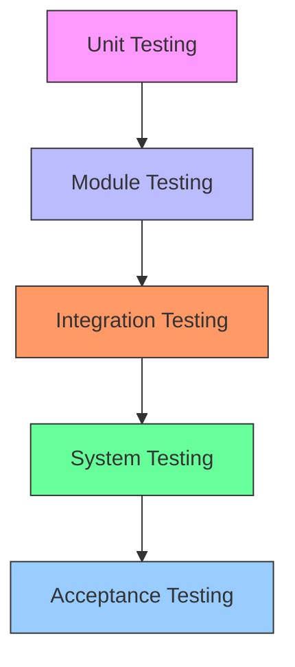

---
type: Concept
title: Test Levels
description: Definition of different test levels in ECMTCP, from component-level to system-level testing.
tags: [testing, ecmtcp, levels, granularity]
status: draft
stale_after: 2027-11-04
generated: { by: opencode/mistral-medium, at: 2026-11-04T00:00:00Z }
sources:
  - id: observation
    resource: "observation:2026-11"
    title: Direct observation of ECMTCP test hierarchy
--- 

# Test Levels

**Test levels** represent the granularity at which tests are applied, ranging from fine-grained component testing to coarse-grained system validation.

**Related concepts**:
- [Test Strategies](./test-strategies.md) — Overall testing approaches and methodologies
- [Test Frameworks](./test-frameworks.md) — Tools for implementing tests at each level
- [Test Environments](../entities/test-environments.md) — Appropriate execution contexts for each level

## Level Hierarchy

### Level 1: Unit/Component Testing
- **Target**: Individual functions, classes, or small modules
- **Isolation**: High - tested in isolation with mocked dependencies
- **Execution**: Developer workstation or CI
- **Speed**: Milliseconds to seconds per test
- **Purpose**: Verify internal logic and edge cases

### Level 2: Module Testing
- **Target**: Collections of related components or subsystems
- **Isolation**: Medium - some real dependencies, some mocked
- **Execution**: Integration environment
- **Speed**: Seconds to minutes per test suite
- **Purpose**: Verify component interactions within a module

### Level 3: Integration Testing
- **Target**: Interactions between major subsystems
- **Isolation**: Low - mostly real dependencies
- **Execution**: Integration or staging environment
- **Speed**: Minutes to tens of minutes per test suite
- **Purpose**: Verify subsystem boundaries and contracts

### Level 4: System Testing
- **Target**: Complete system in production-like configuration
- **Isolation**: None - full integration
- **Execution**: Staging or production-like environment
- **Speed**: Tens of minutes to hours per test suite
- **Purpose**: Validate end-to-end functionality and requirements compliance

### Level 5: Acceptance Testing
- **Target**: System against user requirements and acceptance criteria
- **Isolation**: None - production environment
- **Execution**: Production or pre-production
- **Speed**: Hours to days
- **Purpose**: Confirm system meets business and user requirements

## Level Mapping to ECMTCP Architecture

## Open Questions

- Are there formal definitions for what constitutes each level in ECMTCP?
- How are test levels documented in existing test suites?
