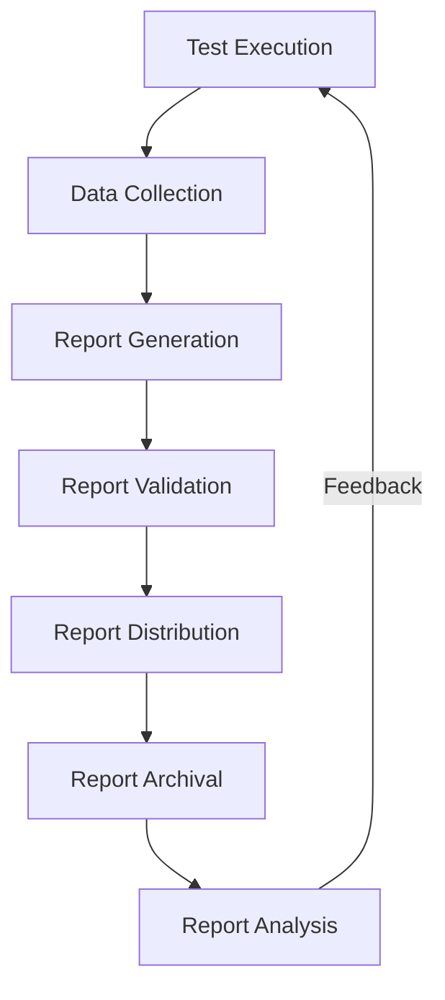

---
type: Tool
title: Test Reports
description: Test reporting mechanisms and outputs used in ECMTCP for communicating test results.
tags: [testing, ecmtcp, reports, metrics, communication]
status: draft
stale_after: 2027-11-04
generated: { by: opencode/mistral-medium, at: 2026-11-04T00:00:00Z }
sources:
  - id: observation
    resource: "observation:2026-11"
    title: Direct observation of ECMTCP test reporting
--- 

# Test Reports

**Test reports** are the structured outputs that communicate test execution results, metrics, and insights to stakeholders in ECMTCP.

**Related concepts**:
- [Test Strategies](../concepts/test-strategies.md) — Testing approaches that generate these reports
- [Test Tools](./test-tools.md) — Tools used for report generation
- [Test Environments](./test-environments.md) — Contexts where report data is collected
- [Test Frameworks](../concepts/test-frameworks.md) — Frameworks that produce reportable results

## Report Types

### Execution Reports
- **Purpose**: Detail the execution of test suites
- **Content**:
  - Tests executed (passed/failed/skipped)
  - Execution time and timestamps
  - Environment details
  - Failure details and stack traces
- **Audience**: Developers, test engineers
- **Frequency**: Per execution

### Coverage Reports
- **Purpose**: Show code coverage achieved by tests
- **Content**:
  - Coverage metrics (line, branch, function)
  - Coverage by module/component
  - Uncovered code regions
  - Coverage trends over time
- **Audience**: Developers, technical leads
- **Frequency**: Per execution or daily

### Quality Reports
- **Purpose**: Assess overall test quality and effectiveness
- **Content**:
  - Test suite health metrics
  - Flakiness analysis
  - Test execution stability
  - Code quality indicators
- **Audience**: Quality assurance, management
- **Frequency**: Weekly or per milestone

### Compliance Reports
- **Purpose**: Verify compliance with testing requirements
- **Content**:
  - Test coverage against requirements
  - Traceability matrix
  - Compliance gaps
  - Remediation status
- **Audience**: Compliance officers, auditors
- **Frequency**: Per release or audit cycle

## Report Formats

| Format | Use Case | Advantages | Limitations |
|--------|----------|------------|-------------|
| HTML | Interactive viewing | Rich visualization, navigable | Not machine-readable |
| PDF | Documentation | Portable, printable | Static, not searchable |
| JSON | Automation | Machine-readable, parseable | Not human-friendly |
| XML | Integration | Standardized, extensible | Verbose |
| CSV | Analysis | Spreadsheet-compatible | Limited structure |
| Markdown | Documentation | Version-controllable, readable | Limited visualization |

## Report Distribution

### Channels
- **Email**: Automated email notifications with summaries
- **Dashboard**: Real-time web dashboards for monitoring
- **File System**: Report files stored for later access
- **API**: Programmatic access to report data
- **Messaging**: Chat/IM notifications for critical failures

### Recipients
- **Developers**: Individual test results, coverage for their code
- **Test Team**: All test execution details and trends
- **Management**: High-level quality metrics and trends
- **Stakeholders**: Compliance and business requirement status

## Report Lifecycle

### Generation Process
1. **Data Collection**: Gather raw test execution data
2. **Data Processing**: Transform and aggregate data
3. **Report Assembly**: Create report structure and content
4. **Quality Check**: Validate report completeness and accuracy
5. **Distribution**: Deliver report to intended recipients

### Archival
- Reports retained for historical analysis
- Versioned alongside code and tests
- Searchable and retrievable
- Retention policies based on report type and criticality

## Report Customization

### Templates
- Standardized templates for each report type
- Customizable sections and formatting
- Branding and styling options

### Filters
- Filter by test suite, component, time period
- Filter by status (pass/fail/skip)
- Filter by severity or priority

## Open Questions

- What are the standardized report templates in ECMTCP?
- How are report retention policies defined and enforced?
- What metrics are tracked for report effectiveness and usage?
